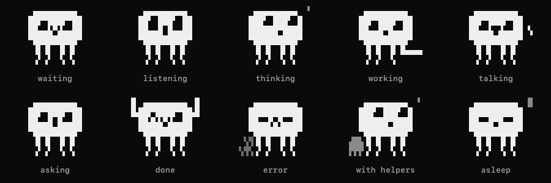

# Oktopus

A pixel octopus that shows what Claude Code is doing: as a status line in the terminal and as a small Mac app in the notch.




- **Status line** (`claude/statusline.sh`): the octopus with an info column (context, usage limits, prompt cache, current tool).
- **Hooks** (`claude/oktopus-hook.sh`): write each session's state to `/tmp/oktopus-<session_id>`.
- **Notch app** (`Sources/Oktopus`): shows the session that most needs attention, knocks when a permission is requested, reports when a session is done, and expands into a list of all sessions on hover. Next to the notch it shows the 5-hour usage limit.

Texts follow the system language: German if it is German, English otherwise (`OKTOPUS_SPRACHE=de|en` overrides it for the status line).

The figure is drawn only in `statusline.sh`; the app runs the script and converts its quarter blocks into pixels.

Requires macOS 15 or later, `jq`, and [Claude Code](https://claude.com/claude-code).

## Install

Download `Oktopus.zip` from the [latest release](../../releases/latest), unzip it and move `Oktopus.app` to Applications. Then set up the status line and hooks:

```bash
cp claude/statusline.sh claude/oktopus-hook.sh ~/.claude/
cp claude/graustufen.json ~/.claude/themes/
# Merge statusLine and hooks from claude/settings-auszug.json into ~/.claude/settings.json
```

Right-click the octopus and choose "Settings …" for an explanation of every gesture and the settings: what is shown next to the notch (5-hour limit, weekly limit, context or nothing), knocking on permission requests, and opening at login. The window also opens on first launch.

## Build from source

```bash
./bauen.sh     # builds ~/Applications/Oktopus.app, ad-hoc signed
./release.sh   # builds, signs with a Developer ID and notarizes dist/Oktopus.zip
```

## License

The source is available under the [PolyForm Noncommercial License 1.0.0](LICENSE): you may use, change and share it for any noncommercial purpose. Commercial use is not permitted.

Made by [0xdeploy.studio](https://0xdeploy.studio).
